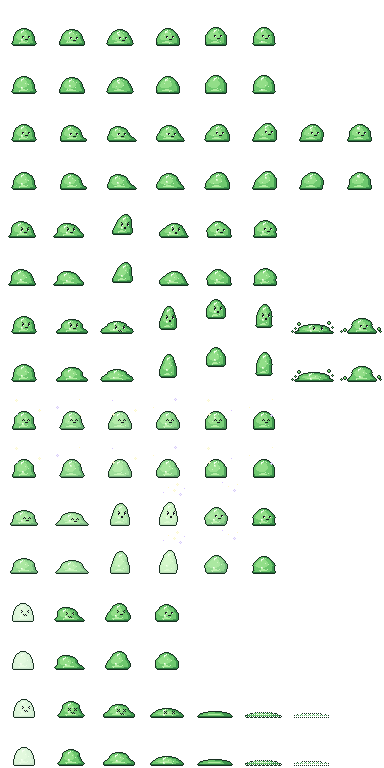

# Planches de combat

En combat (à la Grandia), chaque personnage et chaque ennemi est une image plate animée, posée sur le terrain en 3D. Ses animations viennent d'une **planche** : une seule image découpée en cases de même taille, avec une petite description. On l'ajoute dans la [base de données](10-base-de-donnees.md), fiche du personnage ou de l'ennemi, **Apparence → Planche de combat**.

Exemples (384 × 768, cases de 48 × 48), déjà dans la base du jeu :

- le gluant, [images/planche-gluant.png](images/planche-gluant.png) : un corps de gelée qui s'étale en avançant ;
- le gluant des neiges, [images/planche-gluant-des-neiges.png](images/planche-gluant-des-neiges.png) : la même gelée sous un bonnet de neige, qui fond en flaque ;
- la chauve-souris, [images/planche-chauve-souris.png](images/planche-chauve-souris.png) : elle **vole** au-dessus de ses pieds (le point des pieds reste au sol, sous elle, pour que l'ombre y soit), plonge pour mordre, crie sa magie, tombe au sol en mourant.



## Le découpage

- **Les cases** font toutes la même taille : **48 × 48** par défaut (monstres et personnages), plus grand pour un boss (multiple de 8 conseillé).
- **Une ligne par animation et par direction**, dans cet ordre :
  1. Attente
  2. Marche
  3. Attaque
  4. Attaque forte
  5. Incantation
  6. Magie
  7. Coup reçu
  8. Mort
- Pour chaque animation : la ligne **sud-est** (de face, tourné vers la droite) puis la ligne **nord-est** (de dos, vers la droite).
- **Ouest en miroir** : sud-ouest et nord-ouest sont l'est retourné. Un personnage pas symétrique (une arme dans une main, une cicatrice) décoche le miroir et dessine 4 lignes par animation : sud-est, nord-est, sud-ouest, nord-ouest.
- **Les colonnes** : les images de l'animation, de gauche à droite. Les cases en trop au bout d'une ligne restent vides (transparentes).
- **Les pieds** : un point dans la case (par défaut au milieu, 3 pixels au-dessus du bas), posé sur le sol du combat. **L'ombre ronde est dessinée par le jeu**, pas dans la planche.
- **Sur place** : la marche et les attaques bougent peu dans la case ; c'est le jeu qui déplace le combattant jusqu'à sa cible.

## Les animations

| Animation | Lecture | Images du gluant | Remarque |
|---|---|---|---|
| Attente | en boucle | 6 × 160 ms | entre deux actions |
| Marche | en boucle | 8 × 100 ms | sur place, le jeu le déplace |
| Attaque | une fois | 6 × 90 ms, coup sur l'image 4 | |
| Attaque forte | une fois | 8 × 100 ms, coup sur l'image 7 | |
| Incantation | en boucle | 6 × 140 ms | tant qu'il concentre sa magie (le temps de préparation dans la jauge d'action) ; le frapper à ce moment peut l'interrompre |
| Magie | une fois | 6 × 100 ms, sort lancé sur l'image 4 | l'effet du sort (sa couleur selon l'élément) est dessiné par le jeu |
| Coup reçu | une fois | 4 × 90 ms | |
| Mort | une fois | 7 × 130 ms | la dernière image reste, puis il disparaît et laisse son objet ou son argent (dessinés par le jeu) |

**L'image du coup** : le moment où le coup touche (dégâts, chiffre, interruption de l'action de la cible) ou où le sort part.

Plus tard, les **boss** auront leurs animations à eux, en lignes après la mort, chacune avec un nom ; une compétence choisira l'animation qu'elle joue.

## La fenêtre de la planche

Sans planche, la fenêtre explique le format et propose **Importer un PNG** : les images de chaque animation sont **comptées toutes seules** (jusqu'à la dernière case où quelque chose est dessiné).

**Toujours visibles en haut** (ils restent à l'écran quand on fait défiler le reste) :

- **L'aperçu** joue l'animation choisie. Ses 4 coins choisissent la direction : NO, NE, SO, SE (l'icône miroir marque les directions retournées). En bas, image précédente, pause / lecture, image suivante. L'étiquette en haut indique l'image et « ⚡ coup » sur l'image du coup.
- **Les 8 boutons des animations** (en deux lignes) ; une animation sans image est grisée.

Puis deux onglets :

- **Animations** : la fiche de l'animation choisie.
  - Son nom, sa lecture (en boucle / une fois) et sa durée totale.
  - **Ses images**, découpées dans la planche : en toucher une l'affiche à l'arrêt. **Image du coup** marque l'image affichée (badge ⚡ orange) ; la retoucher enlève la marque.
  - Le nombre d'**images**, la durée **par image** (ms), **en boucle**.
- **Découpage** :
  - en haut, un résumé en vert (« 16 lignes · 8 animations trouvées ») ou les problèmes en orange (l'onglet porte alors un point orange) : une image qui ne se découpe pas en cases, des lignes qui manquent, une animation sans image ;
  - la largeur et la hauteur d'une case, les **pieds** (x, y : une croix orange les montre dans l'aperçu, avec le bord de la case), le miroir ; changer la taille des cases ou le miroir recompte les images ;
  - **la planche** entière, la case jouée entourée en orange ;
  - **Changer l'image** (garde les réglages et recompte) et **Retirer la planche**.

Sur un écran large, la fenêtre a deux colonnes : l'aperçu et les boutons à gauche, les onglets à droite, avec en plus **les 8 animations d'un coup d'œil** (images × durée, image du coup, boucle ; un clic choisit l'animation).

**OK** garde la planche ; **Fermer** (ou Échap, ou toucher à côté) l'oublie.

**L'image fixe** (48 × 48, à côté de la planche) montre le combattant dans les menus et les groupes. Sans image fixe, la première image de l'attente (sud-est) en devient une quand on garde la planche.

## Pour le code

| Fichier | Rôle |
|---|---|
| `src/app/modules/database-editor/shared/sprite-sheet.ts` | Le format (`SpriteSheet`, `SheetAnim`, `SHEET_ANIMS`), la ligne d'une animation dans une direction (`sheetRow`), l'image à un moment (`frameAt`), le comptage des images (`detectFrames`), les problèmes, l'image fixe |
| `src/app/modules/database-editor/sheet-editor/` | La fenêtre de la planche, et sa tuile dans les fiches (`sheet-tile`) |
| `src/app/modules/database-editor/_popup.scss` | Le style des fenêtres par-dessus la base (éditeur pixel, planche) |

La description enregistrée avec l'image :

```json
{
  "image": "data:image/png;base64,…",
  "frame": { "w": 48, "h": 48 },
  "anchor": { "x": 24, "y": 45 },
  "mirror": true,
  "anims": [
    { "id": "idle", "frames": 6, "ms": 160, "loop": true },
    { "id": "attack", "frames": 6, "ms": 90, "loop": false, "hit": 3 }
  ]
}
```

(`hit` compte à partir de 0 : `3` est la 4ᵉ image.)
